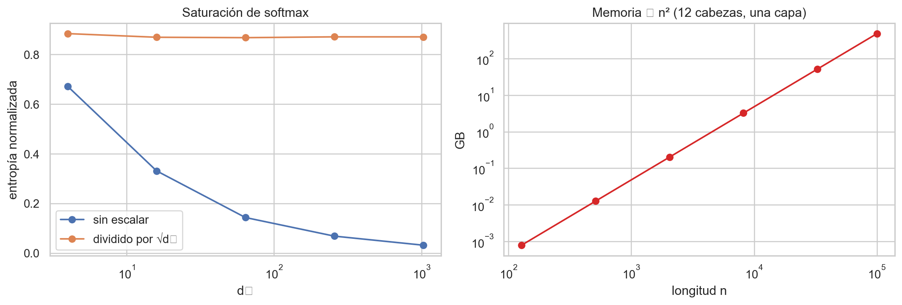
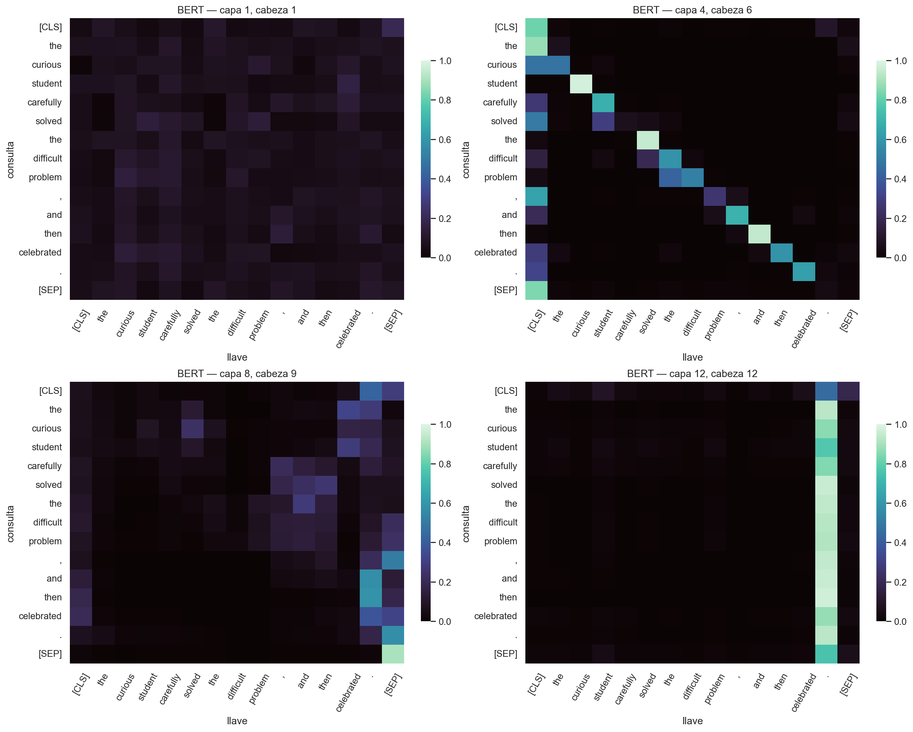
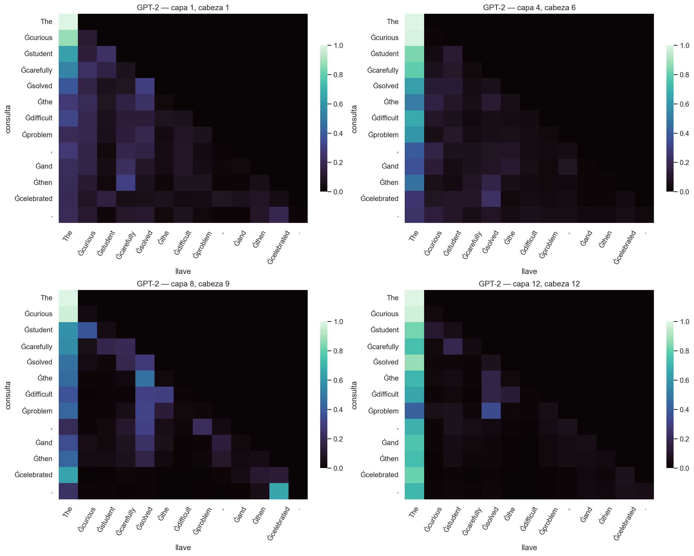
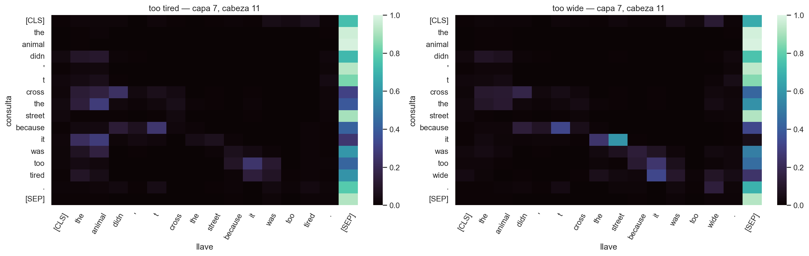
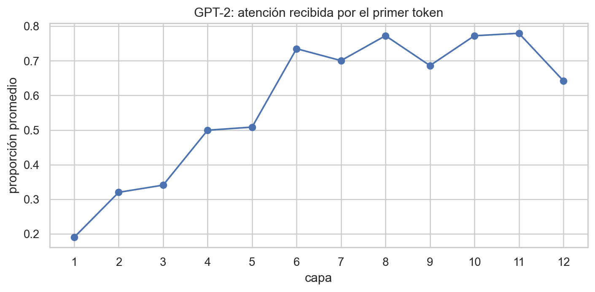
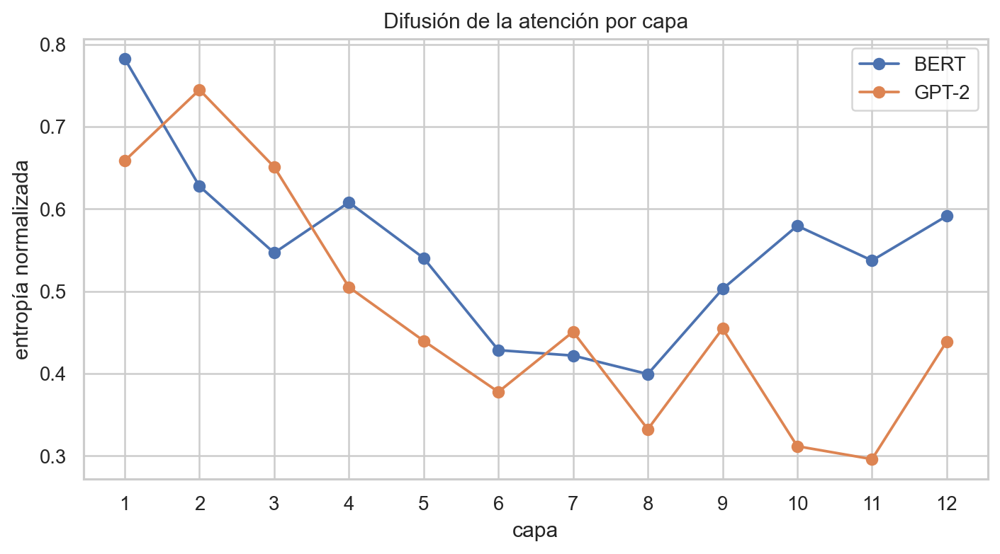

# Transformers y mecanismos de atención

**Curso:** CC3092 — Deep Learning y Sistemas Inteligentes  
**Estudiante:** Sebastian Garcia — **Carné:** 22291

> **Alcance.** El enunciado proporcionado salta de la sección 5 a la 7 y no contiene una sección 6 ni 6.1. Por ello, este reporte no inventa verificaciones ni un ejercicio manual ausentes; presenta todos los demás elementos solicitados. Los experimentos reproducibles están en el notebook del repositorio.

## 1. Investigación: de las RNN a la atención

En un *encoder–decoder* recurrente clásico, el encoder debe comprimir la secuencia completa en un único vector de estado. Este **cuello de botella** obliga a conservar en una representación de tamaño fijo información léxica, sintáctica y semántica; mientras más larga sea la oración, más probable es que se pierdan detalles y que el gradiente deba atravesar demasiados pasos. Bahdanau et al. [1] sustituyen esa única compresión por un contexto distinto en cada paso del decoder: se puntúa cada estado del encoder respecto al estado actual del decoder, se normalizan los puntajes con *softmax* y se forma una suma ponderada. Así, el decoder recupera directamente las partes pertinentes de la entrada.

La **atención aditiva** de Bahdanau usa una red pequeña, típicamente $v^T\tanh(W_q q+W_k k)$; puede relacionar representaciones de dimensiones diferentes, pero añade proyecciones y una no linealidad. La atención **multiplicativa** de Luong usa $q^Tk$ o $q^TWk$. En hardware moderno, el producto punto suele ser más eficiente porque se expresa como multiplicaciones matriciales densas altamente optimizadas.

La analogía de diccionario interpreta la **consulta** $Q$ como lo que se busca, cada **llave** $K$ como un descriptor y cada **valor** $V$ como la información recuperada. No se elige una sola entrada: la similitud entre la consulta y todas las llaves produce una búsqueda “suave”, cuya salida es una mezcla de valores. En *self-attention*, $Q$, $K$ y $V$ son proyecciones aprendidas de la misma secuencia. En *cross-attention*, las consultas provienen del decoder y las llaves y valores de la salida del encoder.

Al eliminar la recurrencia, el Transformer permite procesar en paralelo todos los tokens de una capa y reduce a una sola operación el camino entre dos posiciones cualesquiera. Esto favorece dependencias largas y evita que la señal tenga que atravesar $n$ transiciones recurrentes. No elimina todo problema de optimización, pero sí el orden secuencial obligatorio y el camino recurrente asociado al desvanecimiento del gradiente.

## 2. Investigación: arquitectura Transformer

La atención escalada se define como

$$\operatorname{Attention}(Q,K,V)=\operatorname{softmax}\left(\frac{QK^T}{\sqrt{d_k}}\right)V.$$

Si las componentes de $q$ y $k$ son independientes, de media 0 y varianza 1, entonces $q\cdot k=\sum_{i=1}^{d_k}q_i k_i$ tiene varianza $d_k$. Sin el divisor, los logits crecen con la dimensión, la *softmax* se aproxima a una selección casi discreta y sus gradientes se reducen. Dividir por $\sqrt{d_k}$ mantiene una escala aproximadamente constante [3].

En **multi-head attention**, cada cabeza proyecta la secuencia a un subespacio de dimensión $d_{model}/h$. Esto permite aprender simultáneamente relaciones locales, sintácticas, posicionales o globales. Con $d_{model}$ fijo, usar $h$ cabezas no cambia sustancialmente el número de parámetros: las proyecciones concatenadas de $Q$, $K$, $V$ y salida siguen siendo aproximadamente $4d_{model}^2$; cambia cómo se divide el cálculo.

La atención sin información posicional es equivariante a permutaciones y, por sí sola, no distingue el orden. El Transformer original suma senos y cosenos de distintas frecuencias, lo que no agrega parámetros y permite extrapolar, aunque no siempre generaliza perfectamente fuera de las longitudes vistas. Los *embeddings* posicionales aprendidos son flexibles, pero quedan ligados al máximo entrenado. **RoPE** rota pares de componentes de $Q$ y $K$ según su posición, incorporando desplazamientos relativos directamente en el producto punto [4].

Cada bloque contiene atención, una red *feed-forward* aplicada independientemente a cada posición, conexiones residuales y LayerNorm. La MLP amplía la dimensión, aplica una no linealidad y vuelve a $d_{model}$. En **Post-LN**, usado en el artículo original, se normaliza después de sumar el residual; en **Pre-LN**, se normaliza antes de cada subcapa. Pre-LN ofrece una ruta residual más directa para el gradiente y normalmente estabiliza redes profundas, aunque modifica la dinámica de las representaciones.

La atención estándar requiere $O(n^2d)$ tiempo y $O(n^2)$ memoria por la matriz entre todos los pares. **FlashAttention** conserva la atención exacta y reduce accesos a memoria mediante bloques, pero no elimina el cómputo cuadrático [5]. Las ventanas reducen el costo a $O(nw)$, sacrificando conexiones globales directas; la atención lineal aproxima o reordena el kernel para acercarse a $O(n)$, a cambio de no reproducir exactamente la *softmax* y poder perder calidad.

## 3. Investigación: PyTorch y Hugging Face

- `F.scaled_dot_product_attention(Q,K,V,attn_mask,dropout_p,is_causal,scale)` implementa la operación básica. `attn_mask` restringe pares, `dropout_p` regulariza los pesos, `is_causal` aplica la máscara triangular y `scale` reemplaza $1/\sqrt{d_k}$.
- `nn.MultiheadAttention(embed_dim,num_heads,batch_first,kdim,vdim)` construye atención multicabeza. En `forward`, `key_padding_mask` oculta relleno, `attn_mask` controla pares, `need_weights` solicita los pesos y `average_attn_weights=False` conserva cada cabeza.
- `nn.TransformerEncoderLayer(d_model,nhead,dim_feedforward,dropout,norm_first)` integra atención, MLP, residuales y normalización. `norm_first=True` selecciona Pre-LN. `nn.Transformer.generate_square_subsequent_mask` crea una máscara causal.
- En Hugging Face, `output_attentions=True` devuelve una tupla con un tensor por capa de forma `batch × cabezas × n × n`, después de la *softmax* [8]. Para visualizar matrices se utilizó `attn_implementation="eager"`.

## 4. Metodología y resultados

Se fijó la semilla 22291 y se usaron `bert-base-uncased` y `gpt2`, ambos de 12 capas y 12 cabezas, en modo evaluación. Primero se implementó la fórmula de atención y se comparó con PyTorch: el error máximo fue **0.0**. Luego se simularon consultas y llaves aleatorias para medir la entropía de la *softmax*, y se calculó la memoria de una matriz de atención `float32` con 12 cabezas.

**Interpretación.** Sin escalamiento, la entropía normalizada cae aproximadamente de 0.67 a 0.03 al aumentar $d_k$ de 4 a 1024: la distribución se satura. Con $1/\sqrt{d_k}$ permanece cerca de 0.87. La memoria crece cuadráticamente; a 100,000 tokens, únicamente los pesos de una capa y 12 cabezas requieren cerca de **480 GB**, sin contar gradientes ni otras activaciones.

### Mapas de atención

  
  

En BERT, la capa 1/cabeza 1 es relativamente difusa. La capa 4/cabeza 6 muestra una diagonal desplazada y relaciones locales; la capa 8/cabeza 9 concentra masa en puntuación y tokens de cierre; la capa 12/cabeza 12 dirige casi todas las consultas al punto final. El análisis global confirmó especialización: la mayor masa a la misma posición apareció en capa 12/cabeza 9 (0.429), al token anterior en 7/12 (0.635), al siguiente en 3/10 (0.929), a puntuación en 12/12 (0.870) y a `[CLS]`/`[SEP]` en 2/7 (0.917).

Los mapas de GPT-2 son estrictamente triangulares inferiores: el mayor peso sobre la diagonal superior fue **0.0**. La capa 1/cabeza 1 atiende con fuerza a la posición propia y la capa 4/cabeza 6 al primer token. En capas profundas persiste una columna intensa sobre el primer token. Cuantitativamente, la mayor cabeza de posición propia fue 1/2 (0.968) y la del token anterior 5/12 (0.998); la atención al siguiente token fue 0 por causalidad.

### Pronombres, *attention sinks* y entropía

Se evaluaron las 144 cabezas sin elegir una manualmente. En la **capa 7, cabeza 11**, para *“too tired”*, `it` asignó 0.2843 a `animal` y 0.0671 a `street`; para *“too wide”*, asignó 0.0119 a `animal` y 0.5902 a `street`. Los márgenes fueron 0.2172 y 0.5782, respectivamente. Esto muestra sensibilidad contextual, aunque un peso de atención aislado no prueba cómo se produjo la decisión final.

  
  

La atención promedio de GPT-2 al primer token creció de 0.190 en la capa 1 hasta un máximo de **0.780 en la capa 11**, evidencia compatible con el fenómeno *attention sink* descrito por Xiao et al. [6]. La entropía normalizada descendió globalmente en ambos modelos: BERT pasó de 0.782 en la primera capa a un mínimo de 0.399 en la 8, y GPT-2 de valores altos al inicio a 0.296 en la 11. Las capas profundas fueron, en conjunto, más concentradas, pero la tendencia no fue monótona y BERT volvió a aumentar al final.

## 5. Discusión

La atención permitió escalar más que las RNN porque paraleliza posiciones durante el entrenamiento y acorta a $O(1)$ capas el camino entre tokens, en vez de recorrer secuencialmente $O(n)$ estados. Su límite es que compara todos los pares, por lo que secuencias largas imponen costo cuadrático.

Los máximos observados para posición propia, vecinos, puntuación y tokens especiales apoyan la **especialización de cabezas**, pero no prueban que todas sean útiles. Puede existir redundancia: una ablación por cabeza sería necesaria para medir importancia causal. Del mismo modo, los pesos de atención no son por sí solos explicaciones. Jain y Wallace [7] encontraron baja correlación con importancia por gradiente y distribuciones alternativas con predicciones similares. Wiegreffe y Pinter [9] matizan que la respuesta depende de la definición de explicación y proponen comparar contra controles uniformes, semillas y pruebas adversariales. Aquí los mapas son evidencia descriptiva del flujo interno, no una atribución causal completa.

Todavía preferiría una RNN para *streaming* estricto con estado compacto y memoria limitada, o una CNN cuando predominan patrones locales y se busca costo lineal y alto paralelismo. Para documentos de 100,000 tokens, no usaría atención densa: consideraría ventanas dispersas con tokens globales, procesamiento jerárquico o atención lineal. FlashAttention ayudaría con memoria y velocidad reales, pero no resolvería por sí sola el número cuadrático de productos.

## 6. Conclusiones

El escalamiento por $\sqrt{d_k}$ evitó experimentalmente la saturación; BERT exhibió cabezas especializadas y una cabeza sensible al antecedente contextual; GPT-2 cumplió causalidad exacta y mostró un *attention sink* fuerte. La entropía indicó mayor concentración general en profundidad, con variaciones por arquitectura y capa. En conjunto, la atención mejora paralelismo y acceso a dependencias largas, pero introduce un límite cuadrático y sus mapas deben interpretarse como diagnósticos internos, no como explicaciones completas.

## Referencias

1. Bahdanau, D., Cho, K. y Bengio, Y. (2015). *Neural Machine Translation by Jointly Learning to Align and Translate*. [arXiv:1409.0473](https://arxiv.org/abs/1409.0473).
2. Luong, M.-T., Pham, H. y Manning, C. D. (2015). *Effective Approaches to Attention-based Neural Machine Translation*. [arXiv:1508.04025](https://arxiv.org/abs/1508.04025).
3. Vaswani, A. et al. (2017). *Attention Is All You Need*. [arXiv:1706.03762](https://arxiv.org/abs/1706.03762).
4. Su, J. et al. (2021). *RoFormer: Enhanced Transformer with Rotary Position Embedding*. [arXiv:2104.09864](https://arxiv.org/abs/2104.09864).
5. Dao, T. et al. (2022). *FlashAttention*. [arXiv:2205.14135](https://arxiv.org/abs/2205.14135).
6. Xiao, G. et al. (2023). *Efficient Streaming Language Models with Attention Sinks*. [arXiv:2309.17453](https://arxiv.org/abs/2309.17453).
7. Jain, S. y Wallace, B. C. (2019). *Attention is not Explanation*. [arXiv:1902.10186](https://arxiv.org/abs/1902.10186).
8. PyTorch y Hugging Face. [Scaled dot-product attention](https://pytorch.org/docs/stable/generated/torch.nn.functional.scaled_dot_product_attention.html) y [Model outputs](https://huggingface.co/docs/transformers/main_classes/output).
9. Wiegreffe, S. y Pinter, Y. (2019). *Attention is not not Explanation*. [arXiv:1908.04626](https://arxiv.org/abs/1908.04626).

**Repositorio:** [https://github.com/SebastianUVG/HT2_Deep_Learning.git](https://github.com/SebastianUVG/HT2_Deep_Learning.git)
